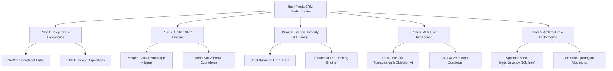

# 🏢 iTechPanda CRM — Comprehensive UX Research & Application Improvement Blueprint

**Executive Operational Audit & Strategic Modernization Roadmap**  
**Date:** November 2026 | **Author:** Lead Systems Architect & UX Researcher (AI Software Company)

---

## Executive Summary

**iTechPanda CRM** is an end-to-end multi-branch education and sales management platform powering admissions across 6 physical campuses (Anna Nagar, Porur, Sholinganallur, T. Nagar, Tambaram, and Velachery). It unites lead capture (Meta Lead Ads, Google Sheets, Website, Walk-ins, WhatsApp), lead allocation, outbound telephony (CallSync Android App), counseling, fee installment schedules, GST invoice generation, and WhatsApp marketing campaigns.

While the technical architecture contains mature features (Daphne ASGI WebSockets, normalized phone matching, multi-tier RBAC, PDF receipts), real-world operational testing across all 8 user personas reveals **friction points, cognitive overload, blind spots, and manual bottlenecks** that slow down team productivity and risk student drop-offs.

This report documents:
1. **The Day-in-the-Life Walkthrough for All 8 User Roles**
2. **Exact Difficulties & Frustrations Faced by Each Persona**
3. **Root Causes in Current Architecture**
4. **Concrete Solutions & Modernization Blueprint**

---

## 1. Role-by-Role User Walkthrough & Difficulty Analysis

---

### Persona 1: Outbound Telecaller (Frontline Agent)
> *"I make 80 to 120 calls every day. Every extra second spent clicking dropdowns, waiting for pages to refresh, or typing notes steals my time to talk to students."*

#### Daily Mission
Dial high volumes of raw leads from Facebook, Instagram, Google, and Website enquiries within 5 minutes of arrival, determine qualification (interest, location, budget), and transfer hot prospects to Admissions Counselors.

#### What They Experience (The Walkthrough)
1. Logs into `/telecaller/dashboard/` and navigates to `/telecaller/leads/`.
2. Locates a lead row, checks the phone number, and clicks the "Call" action.
3. Behind the scenes, the CRM inserts a row into `RemoteOutgoingCall` and waits for their paired mobile phone running the CallSync Android app to pull the job and dial.
4. When the call ends, a modal pops up asking for call notes, call status, and call outcome.
5. Telecaller clicks through dropdowns, writes notes, saves, returns to the table, scrolls down to find the next lead, and repeats.

#### Key Difficulties & Pain Points Faced
1. **The "Silent Phone Disconnect" Blind Spot:**
   - *Problem:* If the Android phone goes to sleep, loses Wi-Fi, or the CallSync app is killed by Android battery optimization, the telecaller clicks "Call" on desktop and **nothing happens**. The remote call sits in `QUEUED` indefinitely.
   - *Frustration:* The telecaller assumes the CRM web app is frozen or broken and repeatedly clicks the button.
   - *Missing Feature:* A live, pulsing **"Phone Connected & Ready" Heartbeat Indicator** in the CRM navbar showing CallSync app battery and sync status (`CallDevice.last_seen_at < 60s`).
2. **Repetitive Form Friction (500+ Clicks/Day):**
   - *Problem:* If a student doesn't answer (RNR - Ring No Response, ~40% of calls), logging it requires opening the disposition modal, picking "RNR" from a dropdown with 8 choices, and clicking save.
   - *Missing Feature:* **1-Click Quick Disposition Hotkeys** on desktop: Pressing `1` = Log RNR & Next, `2` = Busy, `3` = Callback in 2 hrs.
3. **No Continuous "Power Dialer / Autopilot" Queue:**
   - *Problem:* After each call, the telecaller is dumped back onto the paginated table and must manually find the next uncalled lead.
   - *Missing Feature:* A "Start Calling Session" mode that presents leads card-by-card with auto-dialing countdowns.
4. **No Caller ID Pre-lookup:**
   - *Problem:* When an enquirer calls back the telecaller's mobile number, the mobile phone doesn't show a CRM popup of who is calling.

---

### Persona 2: Admissions Counselor (Career Advisor)
> *"My job is closing admissions. I need the full student history in front of me during the call — their WhatsApp questions, prior telecaller notes, and course syllabus — without switching between 5 browser tabs."*

#### Daily Mission
Conduct 20–30 minute in-depth career counseling sessions (phone or face-to-face), recommend the right training track (e.g. Data Analytics, Full Stack Python), configure installment payment plans, and secure initial fee commitments.

#### What They Experience (The Walkthrough)
1. Logs into `/counselor/dashboard/` and views assigned leads in `/counselor/leads/`.
2. Opens a student lead drawer.
3. Switches to `/whatsapp/` in another tab to check if the student messaged on WhatsApp.
4. Switches to `/calls/` to see past recordings.
5. In a negotiation, when a student asks for a ₹3,000 fee waiver, the counselor has to submit a discount approval request (`ApprovedOffer`) and wait for the Sales Head to approve it before creating the enrollment.
6. Opens `/counselor/enroll/`, calculates installments manually, and generates a payment link / QR poster.

#### Key Difficulties & Pain Points Faced
1. **Fragmented 360° Student Timeline:**
   - *Problem:* Telecaller notes are in `CallHistory`, WhatsApp chats are in `chat/inbox`, payments are in `PaymentTransaction`, and status updates are in `LeadStatusHistory`.
   - *Frustration:* The counselor must click multiple tabs while the student is talking.
   - *Solution Needed:* A unified **"Single Pane of Truth" 360° Timeline Drawer** that merges calls, WhatsApp messages, notes, and payments in one chronological feed.
2. **WhatsApp 24-Hour Messaging Policy Confusion:**
   - *Problem:* When a counselor attempts to WhatsApp a student whose last message was >24 hours ago, freeform messages fail silently or raise Meta Graph API policy errors.
   - *Missing Feature:* The chat drawer must display a dynamic countdown badge: `🟢 24h Window Active (18h left)` vs `🟡 Window Expired — Template Required` with a 1-click template picker.
3. **Live Installment Schedule Calculator:**
   - *Problem:* When structuring 3 custom installments, entering unequal dates and amounts often results in math mismatches against the total course fee + 18% GST.
   - *Solution Needed:* An interactive installment slider and schedule builder that automatically balances remaining dues to the exact rupee in real time.
4. **No 1-Click WhatsApp Brochure Delivery:**
   - *Problem:* When a student says "send me the Data Science syllabus", counselors currently download the PDF and manually upload it to WhatsApp.
   - *Solution Needed:* A "Send Course Kit" button right on the lead page that dispatches the pre-configured course brochure PDF and placement report in 1 click.

---

### Persona 3: Sales Head & Manager (Revenue Leader)
> *"I need to know which leads are slipping through the cracks right now, not at the end of the month. If a hot lead sits untouched for 2 hours, that student has already enquired at a competitor."*

#### Daily Mission
Supervise telecaller and counselor pipelines, ensure prompt SLA response times, reassign stagnant leads, approve discount requests, and monitor overall revenue pacing against monthly targets.

#### What They Experience (The Walkthrough)
1. Views `/manager/dashboard/` with high-level KPI tiles.
2. Checks `/manager/leads/` with date and branch filters.
3. Reviews pending discount approval requests (`ApprovedOffer`).
4. Checks reports at `/manager/reports/` for conversion ratios.

#### Key Difficulties & Pain Points Faced
1. **No Real-Time Stale Lead / SLA Breach Alert:**
   - *Problem:* If Facebook leads arrive at 10:00 AM and no telecaller calls by 11:30 AM, there is no visual warning or manager escalation notification.
   - *Solution Needed:* An **SLA Timer Badge** on leads (`⚠️ 1h 45m uncalled`), turning crimson when the 2-hour threshold is breached, with automated reassignment.
2. **Workload Blindness During Bulk Reassignment:**
   - *Problem:* When reassigning 50 stagnant leads from an absent counselor to active counselors, the manager cannot see how many active leads each counselor currently holds.
   - *Solution Needed:* A reassignment modal showing `Counselor Name (Active Leads: 24 | Capacity: Low/Medium/High)`.
3. **Discount Approval Bottleneck:**
   - *Problem:* Discount requests lack real-time push alerts or instant WhatsApp approvals. Counselors lose student deals during live counseling because managers take hours to see the dashboard request.
   - *Solution Needed:* 1-click manager approval via Telegram/WhatsApp webhook or instant browser push notification.

---

### Persona 4: Branch Head & Branch Admin (Campus Operator)
> *"Our branch has physical rent, faculty schedules, and classroom batch capacities. I need to know which batches have empty seats so counselors pitch courses that actually have room."*

#### Daily Mission
Oversee center operations, coordinate local telecallers and counselors, ensure in-center walk-in visitors are attended promptly, and reconcile daily branch cash/card collections.

#### What They Experience (The Walkthrough)
1. Opens `/manager/branch-head/dashboard/`.
2. Filters leads and walk-ins by their specific branch.
3. Manages counselors assigned to that branch.

#### Key Difficulties & Pain Points Faced
1. **Walk-In Lobby Wait Time Blindness:**
   - *Problem:* When a student registers at reception, the Branch Head cannot see how long the student has been waiting in the visitor lounge.
   - *Solution Needed:* A live **"Lobby Queue Board"** showing `Student Name | Arrived: 14 mins ago | Assigned: Priya (Busy) | Status: Waiting`.
2. **Batch Capacity / Classroom Schedule Disconnect:**
   - *Problem:* Courses exist in `products.Product`, but there is no entity representing *Upcoming Batches* (e.g., "Full Stack Weekend Batch - Starts Nov 15 - 18/25 Seats Booked"). Counselors sometimes enroll students into batches that are already at capacity.
   - *Solution Needed:* A lightweight **Batch Management & Seat Counter** linked to the enrollment screen.

---

### Persona 5: Front Desk Receptionist (Campus Welcome)
> *"When a student walks through the front door, they want fast, professional check-in. Asking returning students to fill out the same paper form twice makes us look disorganized."*

#### Daily Mission
Greet physical visitors (students, parents), register their details, assign them to an available counselor, and issue a visitor token or branch standee QR pass.

#### What They Experience (The Walkthrough)
1. Opens `/receptionist/dashboard/`.
2. Enters walk-in visitor details or directs them to scan the standee QR code (`/receptionist/qr-standee/`).
3. Attempts to assign the student to an available counselor.

#### Key Difficulties & Pain Points Faced
1. **Counselor Availability Blindness:**
   - *Problem:* The receptionist doesn't know which counselor is currently in a meeting, on call, or free at their desk. They have to physically walk into counselor cabins to check.
   - *Solution Needed:* A live counselor status chip: `🟢 Available` / `🔴 In Session` / `🟡 On Break`.
2. **Duplicate Entry for Returning Online Enquirers:**
   - *Problem:* When a student who enquired online 2 days ago walks in, entering their phone number should instantly pull up their existing record and preserve their assigned telecaller/counselor.
   - *Solution Needed:* Instant 1-second AJAX phone lookup on the receptionist form that pre-fills name, interested course, and online history.
3. **No Digital Visitor Token / SMS Welcome:**
   - *Problem:* No instant greeting sent to the visitor's phone.
   - *Solution Needed:* Automated WhatsApp/SMS: *"Welcome to iTechPanda Velachery! Your token is #14. Counselor Rajesh will meet you in Cabin 2."*

---

### Persona 6: Accountant & Finance Head (Billing & Audit)
> *"If an invalid or duplicate UTR slips through our verification queue, the company loses money or delivers training without payment."*

#### Daily Mission
Review payment receipts and transaction proofs, verify UPI/NEFT references, approve installments, issue GST Tax Invoices, and monitor overdue fee collections.

#### What They Experience (The Walkthrough)
1. Logs into `/accountant/dashboard/` and checks `/accountant/verification/`.
2. Views submitted payments and uploaded payment screenshots.
3. Verifies transaction references and clicks "Approve" or "Reject".
4. System generates tax invoice and triggers email receipt.

#### Key Difficulties & Pain Points Faced
1. **Duplicate / Reused UTR Vulnerability (Critical Audit Finding):**
   - *Finding in Code:* In `leads/models.py`, `PaymentTransaction.transaction_reference` has `unique=False`.
   - *Risk:* A fraudulent or mistaken student/counselor can submit an identical UTR reference for two different installments or students without the system flagging a duplicate!
   - *Solution Needed:* Strict database constraint and pre-submission validation alerting the accountant: `⚠️ Duplicate UTR! Reference #12345678 was already approved on Lead #412 on Oct 14.`
2. **Unreadable / Cropped Screenshot Friction:**
   - *Problem:* Students upload blurry or cropped phone screenshots where the 12-digit UTR is unreadable. Accountants must reject, message the counselor, and wait days for a clear image.
   - *Solution Needed:* An instant OCR pre-reader on image upload that scans and validates the 12-digit UTR number directly from the screenshot before submission.
3. **Overdue Installment Dunning Sequence:**
   - *Problem:* Tracking students whose fee installments are 5, 10, or 30 days overdue is done via manual dashboard filtering.
   - *Solution Needed:* Automated multi-stage **Dunning Engine**:
     - *T-3 Days:* Friendly WhatsApp reminder with 1-click UPI pay link.
     - *Due Date:* Due date alert.
     - *T+5 Days:* Overdue escalation with notification to the counselor.

---

### Persona 7: Admin & Superadmin (Central Command)
> *"I manage 6 branches, Google Sheets connections, Facebook Lead Ads webhooks, and 50+ staff accounts. I need high system stability and zero data corruption."*

#### Key Difficulties & Pain Points Faced
1. **Google Sheets Fragility:**
   - When branch staff rename a column in Google Sheets or reorder columns, the ingestion pipeline breaks or creates empty lead records.
2. **Telecaller Leave Management Gap:**
   - When a telecaller goes on vacation or sick leave, round-robin lead allocation continues assigning them leads unless an admin manually modifies `TelecallerLeadSetup`.
   - *Solution Needed:* A simple telecaller toggle: `[On Duty / Out of Office]`. When "Out of Office", round-robin automatically skips them.
3. **Monolithic Codebase Complexity:**
   - `leads/views.py` has grown to over **10,000 lines of code**, combining view logic, export handlers, walk-in desks, receipt rendering, and allocation math in a single file. This creates maintenance risks when introducing new features.

---

### Persona 8: Prospective Student & Enquirer (The Customer)
> *"When I submit an inquiry at 10 PM, I want immediate confirmation, course syllabus, and fee clarity — not a random call 24 hours later when I've forgotten I applied."*

#### Key Difficulties & Pain Points Faced
1. **Delayed First Contact for Off-Hours Leads:**
   - Leads submitting forms after 8 PM or on Sundays receive zero immediate engagement until a telecaller logs in the next morning.
   - *Solution Needed:* Instant 24/7 **AI WhatsApp Concierge** that greets the student immediately, answers basic course duration and syllabus queries, and books an appointment for the next morning.
2. **Student Self-Service Portal Absence:**
   - Enrolled students have no portal where they can log in to view their remaining fee balance, download past GST tax invoices, or check their batch class schedule without calling the branch front desk.

---

## 2. Summary Table: Personas, Pain Points & Prescribed Upgrades

| Persona | Core Pain Point | Severity | High-Impact Upgrade |
|---|---|---|---|
| **Telecaller** | No phone connection status; 500+ repetitive clicks/day for RNR/Busy | 🔴 High | Live Phone Heartbeat + 1-Click Desktop Hotkey Dispositions (`1`=RNR, `2`=Busy) |
| **Counselor** | Fragmented student history across 4 tabs; installment math anxiety | 🔴 High | Unified 360° Student Timeline Drawer + Dynamic Installment Balancing Slider |
| **Sales Head** | Stale leads sit untouched without SLA escalation; blind reassignments | 🟡 Med | Visual SLA Escalation Badges (`⚠️ Stale 2h`) + Counselor Workload Capacity Chips |
| **Branch Head** | No visibility into lobby wait times or upcoming batch seat availability | 🟡 Med | Real-Time Lobby Queue Board + Batch Seat Capacity Counter |
| **Receptionist** | Counselor availability blindness; duplicate records for returning leads | 🟡 Med | Live Counselor Duty Status (`🟢 Free` / `🔴 In Session`) + Instant Phone Pre-fill |
| **Accountant** | Duplicate UTR vulnerability (`unique=False`); blurry payment proofs | 🔴 Critical | Strict Duplicate UTR Detection Engine + Payment Screenshot Zoom/OCR Tool |
| **Admin** | Fragile Google Sheets sync; no "Out of Office" toggle for lead allocation | 🟡 Med | "Out of Office" Telecaller Toggle + Column-Tolerant Sheet Ingestion |
| **Student** | Delayed off-hours response; no self-service receipt & balance portal | 🟢 Value | 24/7 AI WhatsApp Concierge + Student Receipt Self-Service Link |

---

## 3. Five-Pillar Strategic Improvement Roadmap

---

### Pillar 1: Telephony & Frontline Ergonomics
1. **CallSync Companion Heartbeat:**
   - Add a lightweight WebSocket ping from the Android app every 30 seconds.
   - Display a status icon in the telecaller navbar: `🟢 CallSync Connected (Battery 84%)` vs `🔴 Phone Offline (Check Wi-Fi)`.
2. **Speed-Dial Disposition Hotkeys:**
   - Allow telecallers to log standard call outcomes using single keyboard shortcuts (`1` for RNR, `2` for Busy, `3` for Not Interested).
   - Instantly advance to the next lead card without full page reload.

### Pillar 2: Unified 360° Student Experience Drawer
1. **Single Chronological Feed:**
   - Consolidate `CallHistory`, WhatsApp `Message`, `PaymentTransaction`, and `LeadStatusHistory` into a single slide-over drawer on every listing page.
2. **Smart Course Kit Dispatch:**
   - 1-click button inside the student drawer to dispatch the official PDF syllabus and brochure directly to the student's WhatsApp number.

### Pillar 3: Financial Integrity & Automated Dunning
1. **Duplicate UTR Protection:**
   - Implement database validation preventing the reuse of existing `transaction_reference` values across payments.
   - Add image zoom and rotation tools to `/accountant/verification/` to ease UTR verification from mobile screenshots.
2. **Automated Installment Dunning Engine:**
   - Scheduled cron running daily at 09:00 AM UTC to trigger polite installment reminder notifications via WhatsApp and email 3 days before due date, on due date, and at 5 days overdue.

### Pillar 4: AI & Next-Generation Intelligence
1. **Live Call Transcription & Real-Time Objection Coaching:**
   - Bridge incoming/outgoing calls from CallSync to speech-to-text (Whisper / Gemini Live API) to provide telecallers with live objection handling prompts (e.g., student says *"fees are too high"* → AI suggests *"mention 0% EMI financing & 100% placement track record"*).
2. **24/7 AI WhatsApp Admissions Bot:**
   - Automated off-hours assistant that answers common student inquiries (fees, timings, syllabus, certifications) and books appointments on the counselor's calendar.

### Pillar 5: Codebase Modularization & System Architecture
1. **Refactor `CRM/leads/views.py` (10,000+ lines):**
   - Split monolithic view code into dedicated modules under `CRM/leads/views/`:
     - `views_desk.py`: Walk-in and receptionist desk.
     - `views_listing.py`: Search, filter, and pagination.
     - `views_export.py`: Excel and CSV reports.
     - `views_allocation.py`: Round-robin and telecaller rules.
2. **Out of Office / Leave Availability Toggle:**
   - Add an `is_available_for_allocation` boolean flag to `accounts.User` so staff taking leave can be temporarily excluded from automated lead distribution without disrupting system rules.

---

## Conclusion & Recommended Next Steps

iTechPanda CRM is functionally rich and robustly built. By eliminating the day-to-day operational friction identified above — especially around **telephony visibility, 1-click telecaller workflows, unified student timelines, and financial UTR safeguards** — the platform will dramatically reduce counselor burnout, prevent lead loss, and maximize enrollment conversion rates across all branches.
