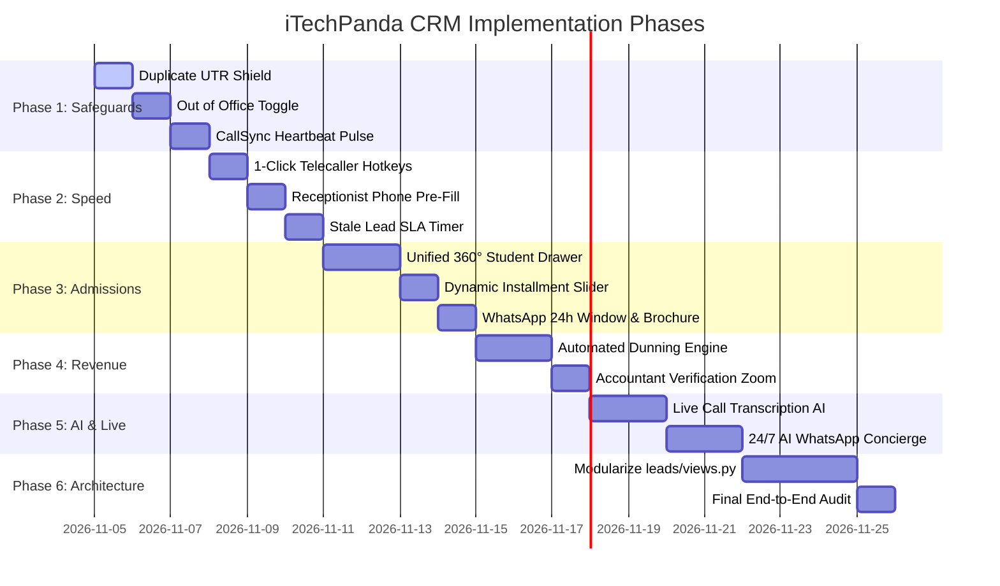

# 🗺️ iTechPanda CRM — Comprehensive Improvement Implementation Map

**Engineering Blueprint, Dependency Graph & Execution Schedule**  
**Date:** November 2026 | **Based on:** `CRM_COMPREHENSIVE_IMPROVEMENT_REPORT.md`

---

## 1. Overview & Strategy

This implementation map converts the findings from the **UX Research & Operational Audit** into a sequenced, non-disruptive engineering roadmap.

The plan is organized into **6 sequential phases**:
- **Phase 1: Financial & Telephony Safeguards** (Zero-risk, high-impact fixes preventing fraud and silent failures)
- **Phase 2: Frontline Speed & Ergonomics** (Saving 500+ clicks/day for Telecallers & Receptionists)
- **Phase 3: Admissions Experience & Unified 360° View** (Single-pane student drawer & live installment calculators)
- **Phase 4: Automated Dunning & Revenue Engines** (Automated fee collection reminders & accountant verification tools)
- **Phase 5: Next-Gen AI & Live Intelligence** (Live call transcription, objection coaching, 24/7 WhatsApp AI concierge)
- **Phase 6: Architectural Resilience & Code Health** (Modularizing monolithic `leads/views.py`)

---

## 2. Phase-by-Phase Engineering Roadmap

---

### Phase 1: Immediate Financial & Telephony Safeguards
*Goal: Eliminate critical fraud risks, allocation errors, and the silent phone disconnect.*

#### Item 139 · Financial Duplicate UTR Shield & Verification Pre-check
- **Target Persona:** Accountant, Finance Head, Institute Owner.
- **Problem Solved:** `PaymentTransaction.transaction_reference` allows duplicate UTR/UPI references, enabling accidental or fraudulent double-credit submissions.
- **Files Modified:**
  - `CRM/leads/models.py`: Add validation and indexed check on `transaction_reference`.
  - `CRM/leads/views_enrollment.py`: Add pre-save duplicate UTR lookup with helpful warning.
  - `CRM/templates/accountant/verification_list.html`: Highlight any duplicate UTR attempts with a red alert badge.
- **Acceptance Criteria:**
  - Submitting an existing `transaction_reference` blocks submission with `⚠️ Error: UTR #... was already recorded on Lead #XYZ on [Date]`.
  - Existing valid records remain unaffected.

#### Item 140 · Telecaller & Counselor "Out of Office / On Duty" Allocation Toggle
- **Target Persona:** Telecaller, Counselor, Admin.
- **Problem Solved:** Absent or sick telecallers continue getting round-robin leads, resulting in untouched leads and burnt marketing money.
- **Files Modified:**
  - `CRM/accounts/models.py`: Add `is_on_duty = models.BooleanField(default=True)`.
  - `CRM/leads/views.py`: Filter `is_on_duty=True` in lead distribution algorithms.
  - `CRM/templates/base.html` / Profile Navbar: Add a 1-click status pill `[🟢 On Duty / 🔴 Out of Office]` for telecallers and counselors.
- **Acceptance Criteria:**
  - Toggling to "Out of Office" immediately excludes the user from round-robin distribution.
  - Toggling back to "On Duty" seamlessly restores them to the rotation.

#### Item 141 · CallSync Android App Heartbeat & Connectivity Status Indicator
- **Target Persona:** Outbound Telecaller.
- **Problem Solved:** Telecallers click "Call" on desktop with no feedback when the companion Android phone is asleep or offline.
- **Files Modified:**
  - `CRM/calls/models.py`: Add heartbeat timestamp and battery percentage to `CallDevice`.
  - `CRM/calls/views.py`: Endpoint `api/call-device/heartbeat/`.
  - `CRM/templates/telecaller_dashboard/dashboard.html` & `templates/telecaller/leads_list.html`: Add live pulsing indicator in navbar (`🟢 CallSync Online (Battery 82%)` vs `🔴 Phone Offline - Reconnect`).
- **Acceptance Criteria:**
  - If `last_seen_at` > 90 seconds, status switches to amber/red with an actionable tooltip.

---

### Phase 2: Frontline Ergonomics & Speed
*Goal: Remove 500+ unnecessary clicks/day for high-volume callers and receptionists.*

#### Item 142 · 1-Click Telecaller Speed-Dial Keyboard Dispositions
- **Target Persona:** Telecaller.
- **Problem Solved:** Logging call outcomes requires opening dropdowns, selecting from 8 options, typing notes, and clicking save 100+ times/day.
- **Files Modified:**
  - `CRM/static/js/telecaller-speeddial.js`: Global keyboard listener when call modal/card is active:
    - Press `1` → Log RNR (Ring No Response) & Auto-advance to next lead.
    - Press `2` → Log Busy & Auto-advance.
    - Press `3` → Schedule Callback for 2 hours later.
    - Press `Enter` → Confirm & Call Next.
  - `CRM/templates/telecaller/leads_list.html`: Hotkey toolbar overlay.
- **Acceptance Criteria:**
  - Telecallers can disposition an unanswered call in under 1 second without touching their mouse.

#### Item 143 · Receptionist 1-Second Instant Phone Pre-Fill & Counselor Duty Status
- **Target Persona:** Receptionist, Branch Head.
- **Problem Solved:** Returning online enquirers get re-entered as duplicate walk-ins; receptionists don't know which counselor is free.
- **Files Modified:**
  - `CRM/leads/views_walkin.py`: Fast AJAX endpoint `/receptionist/api/check-phone/?q=...`.
  - `CRM/templates/receptionist/dashboard.html`: Auto-completes student name, previous online source, and assigned counselor as soon as 10 digits are typed.
  - Add Counselor Duty Status chips: `🟢 Free in Cabin` / `🔴 In Session` / `🟡 On Break`.
- **Acceptance Criteria:**
  - Typing an existing 10-digit number fills name and interested course in < 300ms.

#### Item 144 · Sales Head Stale Lead Visual SLA Escalation Timer
- **Target Persona:** Sales Head, Manager.
- **Problem Solved:** Hot Meta leads sit uncalled for hours without manager visibility.
- **Files Modified:**
  - `CRM/templates/manager/leads_list.html` & `templates/admin/leads_list.html`.
  - `CRM/static/css/crm.css`: Dynamic SLA timer badge:
    - `< 30 mins`: Neutral gray badge.
    - `30m - 2h`: Amber warning badge.
    - `> 2h uncalled`: Crimson pulsing badge (`⚠️ SLA Breached: 2h 15m uncalled`).
- **Acceptance Criteria:**
  - Managers can sort by SLA age and 1-click reassign all breached leads to active telecallers.

---

### Phase 3: Admissions Experience & Unified 360° View
*Goal: Provide counselors with total student context in a single pane and eliminate installment math errors.*

#### Item 145 · Unified 360° Student Slide-over Drawer
- **Target Persona:** Counselor, Sales Head, Admin.
- **Problem Solved:** Counselor has to switch between 4 browser tabs (leads, calls, WhatsApp, payments) during a live counseling call.
- **Files Modified:**
  - `CRM/templates/components/student_360_drawer.html` (Shared partial).
  - `CRM/static/js/student-360-drawer.js` & `CRM/static/css/student-360-drawer.css`.
  - Merged timeline aggregator querying `CallHistory`, `chat.Message`, `PaymentTransaction`, and `LeadStatusHistory` chronologically.
- **Acceptance Criteria:**
  - Clicking any student row opens a slide-over panel displaying the full conversation, call audio playback, and payment history in one view.

#### Item 146 · Dynamic Installment Balancing Slider
- **Target Persona:** Counselor, Student.
- **Problem Solved:** Calculating custom installment dates, down payments, and GST split (18%) during high-stakes student negotiations is prone to math errors.
- **Files Modified:**
  - `CRM/templates/leads/enrollment_form.html`.
  - `CRM/static/js/installment-calculator.js`.
- **Acceptance Criteria:**
  - Interactive slider where adjusting the down payment or installment #1 automatically auto-balances the remaining installments down to the exact rupee with instant GST breakdown.

#### Item 147 · WhatsApp 24-Hour Policy Window Countdown & 1-Click Brochure Dispatch
- **Target Persona:** Counselor, Telecaller.
- **Problem Solved:** Messages fail silently when student last messaged >24h ago; manual brochure uploading is tedious.
- **Files Modified:**
  - `CRM/chat/whatsapp/client.py` & `CRM/chat/views.py`.
  - `CRM/templates/chat/inbox.html` & `student_360_drawer.html`.
  - Dynamic countdown timer badge (`🟢 24h Window: 18h left` vs `🟡 Expired — Template Required`).
  - 1-Click "Send Course Kit" button sending pre-configured syllabus PDF directly to student WhatsApp.
- **Acceptance Criteria:**
  - Displays remaining window time and switches input to template selector when expired.

---

### Phase 4: Revenue Automation & Dunning Engine
*Goal: Ensure fee collections happen on time without manual counselor chasing.*

#### Item 148 · Automated Overdue Installment Dunning Engine
- **Target Persona:** Accountant, Finance Head, Student.
- **Problem Solved:** Chasing students for overdue fee installments is done manually.
- **Files Modified:**
  - `CRM/finance/dunning.py`: Automated dunning engine.
  - Multi-stage cadence:
    - *T-3 Days:* Polite WhatsApp & Email notice with 1-click UPI pay link.
    - *Due Date:* Due date reminder.
    - *T+5 Days:* Overdue escalation with counselor notification.
  - `CRM/config/settings.py` / Celery or management command `python manage.py run_dunning_cycle`.
- **Acceptance Criteria:**
  - Triggers automated notifications on scheduled intervals and logs all dispatches in `PaymentEmailLog`.

#### Item 149 · Accountant Verification Image Zoom & Rotation Lightbox
- **Target Persona:** Accountant.
- **Problem Solved:** Mobile screenshots of UPI transactions are often blurry, upside down, or tiny.
- **Files Modified:**
  - `CRM/templates/accountant/verification_list.html`.
  - Add lightbox modal with 2x/4x smooth zoom, 90° rotation, and contrast enhancement filter.
- **Acceptance Criteria:**
  - Accountants can inspect 12-digit UTR numbers without downloading images to desktop.

---

### Phase 5: Next-Gen AI & Live Intelligence
*Goal: Equip telecallers with live AI coaching and capture off-hours student leads 24/7.*

#### Item 150 · Live Call Transcription & Real-Time Objection AI Coaching Bridge
- **Target Persona:** Telecaller, Counselor, Sales Head.
- **Problem Solved:** Junior telecallers struggle with objection handling (e.g., "fees too high", "no time for classes").
- **Files Modified:**
  - `CRM/calls/ai_coaching.py`: Audio chunk streamer / transcript ingestion.
  - WebSocket channel `ws/call-assist/<call_id>/`.
  - Real-time prompt cards on telecaller screen: e.g., Student: *"It's too expensive"* → AI Prompt: *"Highlight 100% placement record, average 6.5 LPA starting package, and ₹3,500/mo no-cost EMI."*
- **Acceptance Criteria:**
  - Real-time coaching prompts appear within 2 seconds of student speaking an objection keyword.

#### Item 151 · 24/7 AI WhatsApp Admissions Concierge Bot for Off-Hours Inquiries
- **Target Persona:** Prospective Student, Admin.
- **Problem Solved:** Leads arriving after 8 PM or on Sundays receive zero engagement for 12+ hours.
- **Files Modified:**
  - `CRM/chat/whatsapp/ai_concierge.py`.
  - Integration with Gemini Flash / custom LLM knowledge base of iTechPanda courses, duration, fees, and campus locations.
  - Books appointment directly onto branch counselor calendar.
- **Acceptance Criteria:**
  - Answers off-hours student queries within 5 seconds and marks lead as "Appointment Booked".

---

### Phase 6: Architectural Resilience & Code Health
*Goal: Future-proof codebase maintainability and ensure zero regressions.*

#### Item 152 · Modularization of Monolithic `CRM/leads/views.py` (10,000+ Lines)
- **Target Persona:** Developers, Central IT.
- **Problem Solved:** 10k-line file is fragile, difficult to navigate, and prone to merge conflicts.
- **Files Modified:**
  - Split `CRM/leads/views.py` into `CRM/leads/views/`:
    - `__init__.py`: Backward-compatible re-exports.
    - `views_listing.py`: Leads table, filters, KPIs.
    - `views_desk.py`: Walk-in desk, token printer.
    - `views_export.py`: Excel and CSV data pipelines.
    - `views_allocation.py`: Round-robin and telecaller rules.
- **Acceptance Criteria:**
  - Every single existing URL route continues functioning with 100% backward compatibility and 0 broken imports.

#### Item 153 · End-to-End System Audit, Verification Suite & Load Checks
- **Target Persona:** Founder, Superadmin.
- **Acceptance Criteria:**
  - Run `python manage.py check` → 0 issues.
  - Run `stub_scan.py` → 0 blockers.
  - Automated browser crawler across all 18 pages and 8 roles → 0 DEAD links, 0 console errors.

---

## 3. Recommended Phased Implementation Schedule

| Phase | Focus Area | Impact | Estimated Duration |
|---|---|---|---|
| **Phase 1** | Duplicate UTR Shield + Out of Office Toggle + CallSync Heartbeat | 🔴 Critical | 2–3 Days |
| **Phase 2** | 1-Click Telecaller Hotkeys + Receptionist Pre-fill + SLA Timers | 🟡 High Speed | 2–3 Days |
| **Phase 3** | Unified 360° Student Drawer + Dynamic Installment Calculator | 🔴 Core UX | 3–4 Days |
| **Phase 4** | Automated Dunning Engine + Accountant Zoom Lightbox | 🟡 Revenue | 2–3 Days |
| **Phase 5** | Live Call Transcription AI + 24/7 WhatsApp AI Concierge | 🟢 Next-Gen | 4–5 Days |
| **Phase 6** | Modularize `leads/views.py` + Full Regression Suite | 🔵 Architecture | 3–4 Days |

---

*This implementation map provides a structured, predictable path to transform iTechPanda CRM into a modern, high-converting enterprise admissions engine.*
