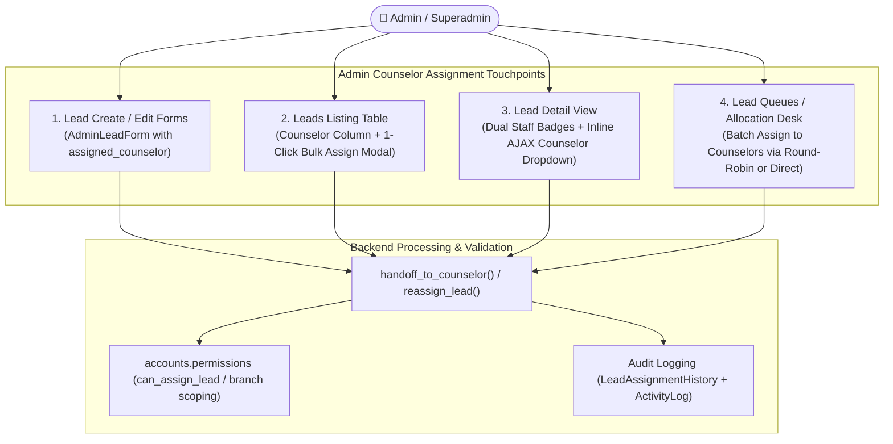

# DigiPanda CRM — Implementation Plan: Admin Lead Assignment to Counselors
**Author:** AI Software Company (00 Orchestrator, 05b UI Designer, 06a Backend Developer)  
**Target:** DigiPanda CRM (`http://127.0.0.1:8000/`)  
**Scope:** Enable Superadmin / Admin to assign leads to Counselors across Create, Edit, Lead Detail, Bulk Table Operations, and Assignment Queues.  
**Date:** November 2, 2026  
**Status:** 📋 PROPOSED FOR FOUNDER APPROVAL  

---

## 1. Problem Statement & Business Context

Currently in DigiPanda CRM:
1. **Creation & Edit Gaps:** When an Admin creates a new lead (`/admin/leads/create/`) or edits an existing lead (`/admin/leads/<id>/edit/`), `AdminLeadForm` only provides inputs for `assigned_manager` and `assigned_telecaller`. There is **no `assigned_counselor` field**.
2. **Table Visibility & Bulk Actions Gaps:** On the main Admin Leads Listing (`/admin/leads/`), the table displays Manager and Telecaller columns, but **omits the Counselor column**. While bulk actions support Telecaller reassignment, there is no quick, dedicated **"Assign to Counselor"** 1-click modal for selected leads.
3. **Lead Detail View Gaps:** On `/admin/leads/<id>/`, the header badge merges staff under a single `assignee` variable that prioritizes the telecaller, hiding the assigned counselor if both are assigned. Neither Column 1 nor Column 2 contains an editable Counselor field with instant inline AJAX assignment.
4. **Queue Allocation Gaps:** On `/admin/lead-queues/`, the workload distribution system only distributes leads to Telecallers, with no option to batch-allocate qualified or walk-in leads directly to Counselors.

---

## 2. Solution Architecture & Key Touchpoints



---

## 3. Detailed Touchpoint Specifications

### Touchpoint 1: Admin Lead Create & Edit Forms
- **File:** [`leads/forms.py`](file:///d:/CRM_Integrated_v2/CRM_Integrated_v2/CRM/leads/forms.py) (`AdminLeadForm`), [`templates/admin/lead_create.html`](file:///d:/CRM_Integrated_v2/CRM_Integrated_v2/CRM/templates/admin/lead_create.html), [`templates/admin/lead_edit.html`](file:///d:/CRM_Integrated_v2/CRM_Integrated_v2/CRM/templates/admin/lead_edit.html).
- **Changes:**
  1. Add `assigned_counselor` to `AdminLeadForm`:
     ```python
     assigned_counselor = forms.ModelChoiceField(
         queryset=User.objects.filter(role=UserRole.COUNSELOR, is_active=True),
         required=False,
         empty_label="-- Select Counselor (Optional) --",
         widget=forms.Select(attrs={'class': 'form-select'})
     )
     ```
  2. Include `'assigned_counselor'` in `Meta.fields`.
  3. In `lead_create.html`: Add an "Assignment Section" showing Manager, Telecaller, and Counselor selectors so Admin can directly route the lead upon creation.
  4. In `lead_edit.html`: Render `form.assigned_counselor` alongside `form.assigned_telecaller`.

---

### Touchpoint 2: Admin Leads Listing Table & 1-Click Bulk Counselor Assign Modal
- **File:** [`templates/admin/leads_list.html`](file:///d:/CRM_Integrated_v2/CRM_Integrated_v2/CRM/templates/admin/leads_list.html), [`leads/views.py`](file:///d:/CRM_Integrated_v2/CRM_Integrated_v2/CRM/leads/views.py).
- **Changes:**
  1. **Table Header & Columns:** Add **"Counselor"** column between Telecaller and Course.
     - Displays counselor name with avatar badge (or `-` if unassigned).
     - Allows instant visual audit of counselor workload directly from the main table.
  2. **Bulk Actions Menu Enhancement:**
     - In the bulk actions dropdown, add **"Assign to Counselor"** with a dedicated user-group icon.
  3. **Dedicated Bulk Counselor Assignment Modal:**
     - A clean, modern dialog:
       * Shows selected count (e.g. *"Assign 15 selected leads to Counselor"*).
       * Dropdown of active Counselors (optionally filtered by branch).
       * Optional transfer notes/remarks (e.g. *"Walk-in counseling follow-up"*).
       * Sends POST to `/api/leads/bulk-action/` with `action: 'reassign_counselor'`, `lead_ids: [...]`, `counselor_id: ...`.
       * Refreshes table via instant AJAX without losing filters.

---

### Touchpoint 3: Lead Detail View (Dual Staff Badges + Inline AJAX Assignment)
- **File:** [`leads/detail_service.py`](file:///d:/CRM_Integrated_v2/CRM_Integrated_v2/CRM/leads/detail_service.py), [`templates/leads/lead_detail_view.html`](file:///d:/CRM_Integrated_v2/CRM_Integrated_v2/CRM/templates/leads/lead_detail_view.html).
- **Changes:**
  1. **Dual Staff Badges in Header:**
     - Replace the single combined assignee badge with clear dual badges when both exist:
       * **Telecaller Badge:** 📞 Telecaller Name
       * **Counselor Badge:** 🎓 Counselor Name (or `+ Assign Counselor` pill if unassigned).
  2. **Dedicated Inline Editable Counselor Field:**
     - Add `assigned_counselor` in the lead metadata grid with control type `select` and active counselors list.
     - On selection change, sends AJAX request to `update_lead_attribute` or `api_reassign_lead_to_counselor`, updating the database and writing to the activity timeline in real-time.

---

### Touchpoint 4: Admin Lead Queues / Allocation Desk
- **File:** [`templates/admin/lead_queues.html`](file:///d:/CRM_Integrated_v2/CRM_Integrated_v2/CRM/templates/admin/lead_queues.html), [`leads/views.py`](file:///d:/CRM_Integrated_v2/CRM_Integrated_v2/CRM/leads/views.py) (`admin_lead_queues`).
- **Changes:**
  1. In the Bulk Assign Modal on `/admin/lead-queues/`, provide a role toggle:
     - `Assign to: [ Telecallers ] | [ Counselors ]`
  2. When "Counselors" is selected:
     - Displays list of active Counselors and their current active lead counts.
     - Allows selecting a single counselor or multi-counselor Round-Robin distribution.

---

## 4. Implementation Steps & Acceptance Criteria

| Item | Task Description | Target Files | Acceptance Verification |
|---|---|---|---|
| **1** | Add `assigned_counselor` to `AdminLeadForm` & template views | `leads/forms.py`, `admin/lead_create.html`, `admin/lead_edit.html` | Creating or editing a lead with a selected Counselor properly saves `assigned_counselor` in the DB. |
| **2** | Add Counselor column & 1-Click Bulk Assign Modal on `/admin/leads/` | `templates/admin/leads_list.html`, `leads/views.py` | Admin selects multiple leads, clicks "Assign to Counselor", chooses a counselor, and all leads update with audit log. |
| **3** | Lead Detail View: Dual Staff Badges & Inline Counselor Dropdown | `leads/detail_service.py`, `templates/leads/lead_detail_view.html` | Detail view displays both Telecaller and Counselor; changing Counselor inline updates live via AJAX. |
| **4** | Queue Allocation: Support Counselor batch allocation | `templates/admin/lead_queues.html`, `leads/views.py` | Queue modal allows allocating unassigned/interested leads to Counselors. |
| **5** | Automated Test Suite & Visual Verification | `scratch/test_counselor_assignment.py` | 100% green tests verifying permissions, single assign, bulk assign, form saves, and audit history. |

---

## 5. Decision Checkpoints for Founder

1. **Dual Staff Model:** A lead can have **both** an assigned Telecaller (who dials and qualifies) and an assigned Counselor (who provides course guidance and conducts demo/enrollment). Does this match your intended workflow? *(Recommended: Yes)*
2. **Branch Constraints:** When an Admin assigns a lead to a counselor, should the counselor dropdown be filtered to only counselors belonging to the lead's branch, or can Admin assign across any branch? *(Recommended: Default to the lead's branch, with an option to select "All Branches" for Superadmin)*.
